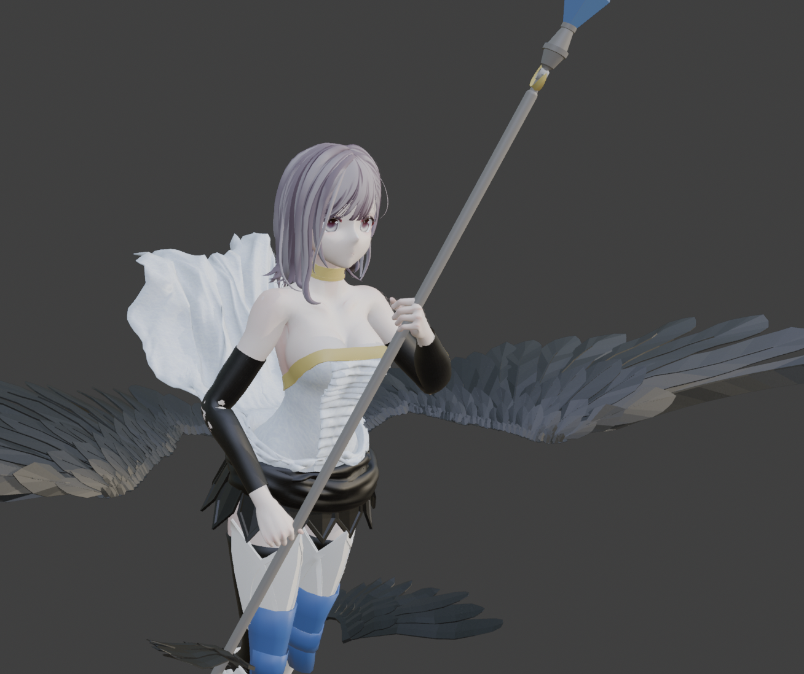
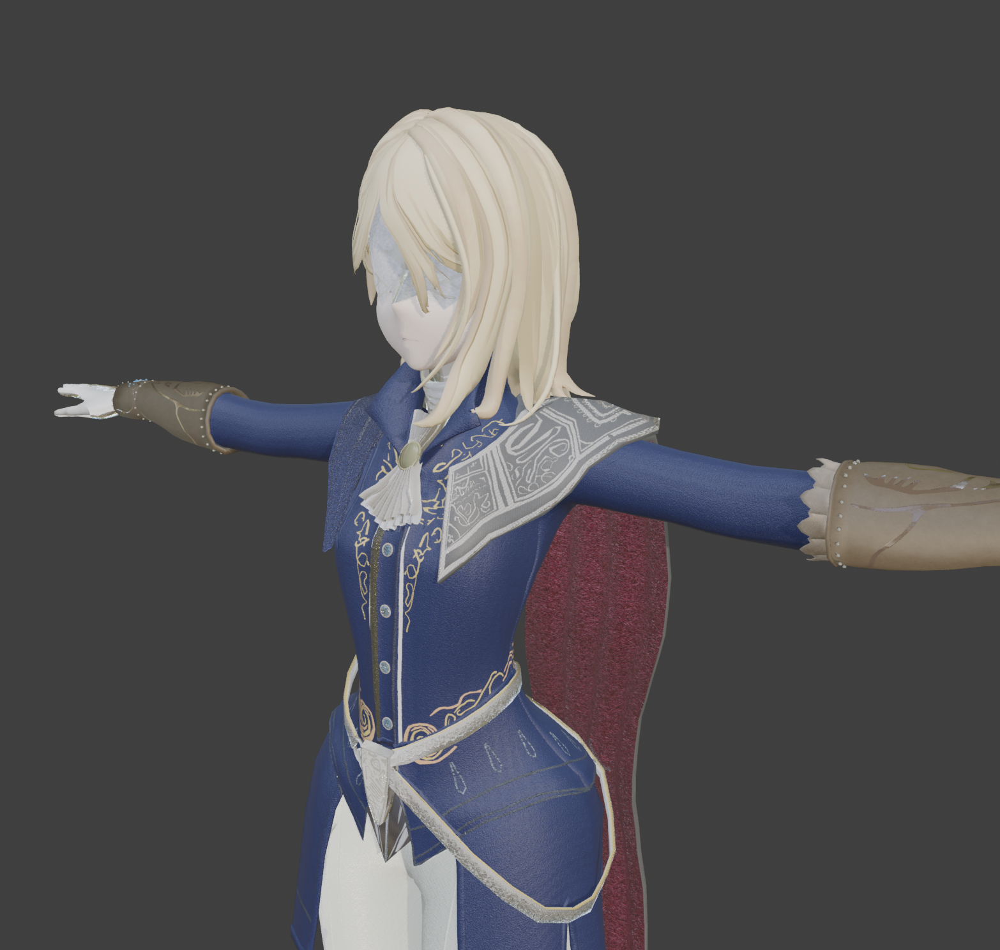
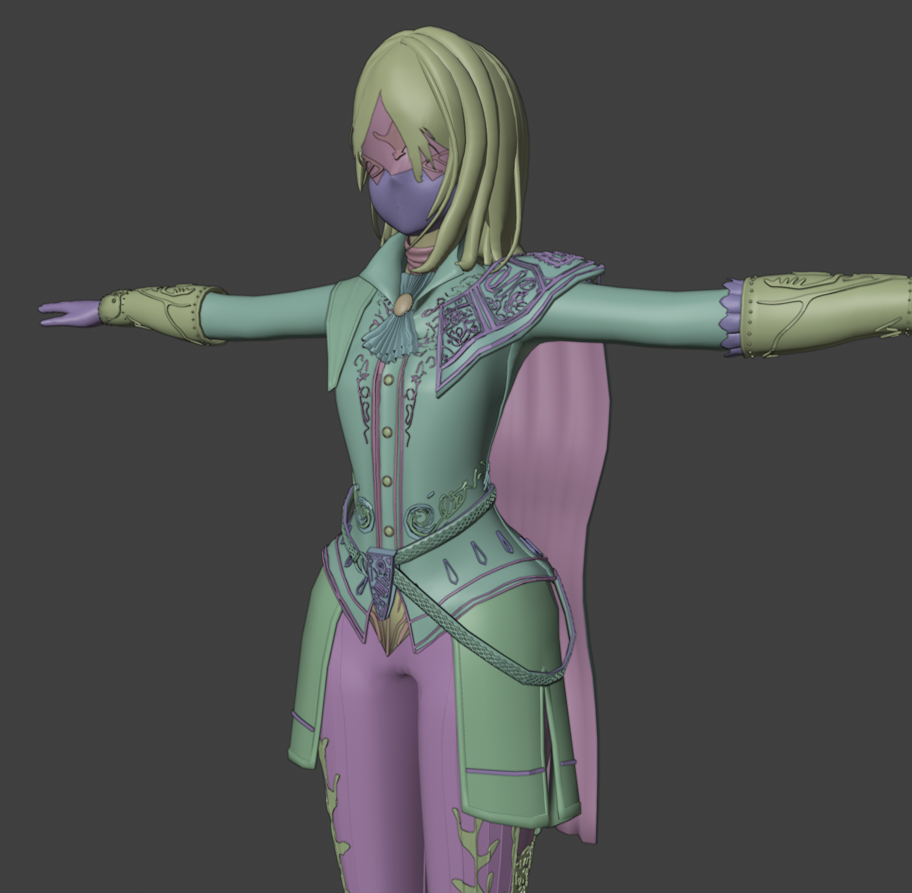

# Portfolio

ゲームプログラマーとして、ゲーム開発を中心に、macOSアプリケーション開発や3Dキャラクター制作にも取り組んでいます。

## Games

### Pg — パズルゲーム

Unity / C#

[GitHub — Pg](https://github.com/kuniyoshi/Pg)

盤面にある六角形の宝石を入れ替えて移動させ、同じ種類の宝石を4つ以上揃えて消すターン制パズルゲームです。

形にすることと、設計を確認することを目標に作ったものです。2021年のものですが2026年に環境を更新してあります。

制限ターン内で目標スコアの達成を目指します。

**技術的な特徴**

- ゲームロジックと表示処理の分離: シミュレーションと表示とを同期的に進める設計をよく見かけますが、本設計では可能な限り分離しています。つまり、プレイヤーの一つの操作で起きる変化をシミュレーションし切った後に表示フェーズに入ります。
- シミュレーションを分離することでテストしやすくなったり、バランス調整しやすくなったり、自動生成しやすくなったりしますが、今回はビームサーチによるヒント機能を実装してあります。

<video src="https://raw.githubusercontent.com/kuniyoshi/Pg/main/Documents/play.mov" controls preload="metadata" width="100%"></video>

### Gw — 3Dアクションゲーム（開発中）

Unity / C# / Blender

[GitHub — Gw](https://github.com/kuniyoshi/Gw)

滑空、急降下、一撃離脱をテーマにした3Dアクションゲームです。

高度と速度の変化を活かし、飛行そのものが気持ちよくなる操作感を目指しています。自分が楽しむために作成中です。

**実装・検証中の要素**

- 滑空と落下による移動
- 急降下攻撃と攻撃後の上昇
- 飛行角度に応じた挙動の変化

<video src="media/gw/gameplay.mp4" controls preload="metadata" width="100%"></video>

※ 3D モデルはリポジトリに含めていないのでプレイはできないと思います。

## Applications

### Tima — 時間管理アプリ

macOS / Swift

作業時間の計測とタイムボックスによる作業管理を行うmacOSアプリケーションです。

**主な機能**

- 作業ごとの時間計測
- タイムボックスと休憩の管理
- キーボード中心の操作
- データのインポート・エクスポート

[GitHub — Tima](https://github.com/kuniyoshi/Tima)

## 3D Modeling

Blender / Substance 3D Painter

### Character Model A

<video src="media/models/a.mp4" controls preload="metadata" width="100%"></video>

※ 顔と髪は既成のもので、素体も使ってます。いずれもsonoさんのQuQuモデルです。

### Character Model B

<video src="media/models/b.mp4" controls preload="metadata" width="100%"></video>

※ 顔と髪は既成のもので、素体も使ってます。いずれもsonoさんのQuQuモデルです。

## Technical Articles

### Zenn

- [誰も見ない分報を1年間書き続けた](https://zenn.dev/pura/articles/2105ee9ca426fa)
- [数字は日本語で発音すると短い](https://zenn.dev/pura/articles/34955ac5ddf99b)
- [シングルトンクラスには `The` ってつけよう](https://zenn.dev/pura/articles/cf6de58af5fea3)
- [一覧](https://zenn.dev/pura?tab=articles)

### Qiita

- [TypeScript で if-else を switch にしたらエンバグした話](https://qiita.com/kuniyoshi14/items/db22e7536d533b99277d)
- [SerializeField と null 許容参照型の問題を解決したらボーナスがあった](https://qiita.com/kuniyoshi14/items/d4653ca03aecb517b387)
- [一覧](https://qiita.com/kuniyoshi14)

## Programming Skills & Activities

### AtCoder

**最高レーティング：852（緑）**

アルゴリズム部門で緑ランクに到達。

[AtCoder — pura_kuniyoshi](https://atcoder.jp/users/pura_kuniyoshi)

## Links

- [GitHub](https://github.com/kuniyoshi)
- [Zenn](https://zenn.dev/pura)
- [Qiita](https://qiita.com/kuniyoshi14)
- [AtCoder](https://atcoder.jp/users/pura_kuniyoshi)
